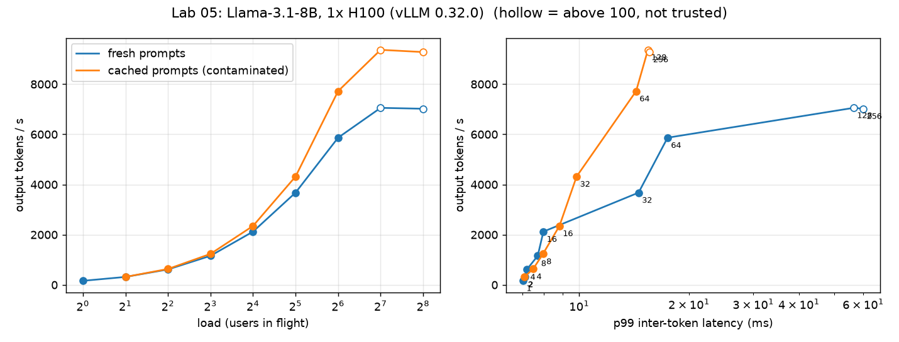

# Lab 05: vLLM baseline, concurrency sweep and cost per token

**Status:** Measured. Levels up to 64 users are trustworthy; levels 128 and 256 are **invalid as labelled** (see Correction) and need a re-run.  
**Baseten posting items:** "benchmarking frameworks", "tokens per GPU-hour, utilization, latency/throughput/cost tradeoffs", "profile where performance is held back"  
**Needs:** 1× H100 80GB SXM at $3.99/h; about 25 minutes including install and model load. · **Depends on:** Labs 01-04 (concepts)

## 1. The question
On one H100, how does output throughput, latency and cost per token change as more users share the GPU, and where does it stop improving?

## 2. Mental model

### 2.1 What a serving engine is
A request passes through: **HTTP API server → tokenizer → scheduler → model runner (GPU) → detokenizer → streamed response**.
The part that matters for performance is the **scheduler**. Every step (about 6-8 ms here) it decides which requests run: all
currently-decoding sequences, plus waiting requests whose prompts it can start, subject to limits:
- `max_num_seqs`: the most sequences in one step.
- `max_num_batched_tokens`: the most tokens (prefill chunks + one per decoding sequence) in one step.
- KV-cache blocks: a request cannot start unless blocks exist for its prompt.
Requests beyond these limits wait in a queue; that waiting is part of TTFT.

### 2.2 Continuous batching (Lab 03, §2.4)
Finished sequences leave and waiting ones join at every step, so the batch stays full. Combined with PagedAttention (Lab 02, §2.6)
this is what lets one GPU serve dozens to hundreds of users.

### 2.3 Metrics, precisely
| Metric | Definition | Driven by |
|---|---|---|
| TTFT | request sent → first token | queueing + prefill |
| ITL | gap between consecutive streamed chunks | decode step time under load |
| TPOT | (E2E − TTFT) ÷ (output tokens − 1) | mean decode speed one user sees |
| E2E | request sent → last token | TTFT + (n − 1) × TPOT |
| Throughput | output tokens/s across all users | batch size, bandwidth |
| Goodput | throughput of requests that met the latency targets | what customers actually get |
Always report p50 **and** p99: the median is the typical user, p99 is the unlucky one.

### 2.4 Load generation: closed vs open loop, and Little's law
- **Closed loop** (this lab): a fixed number N of users, each sending the next request when the last finishes. Simple, but the load adapts to the server, so it cannot show collapse.
- **Open loop**: requests arrive at a rate regardless of completions (Poisson arrivals). If the rate exceeds capacity, queues grow without bound: the true failure mode of a production service.
- **Little's law**: average requests in the system = arrival rate × average time in the system (`L = λ·W`). At a throughput of 55 requests/s and 100 users in flight, each request averages `100 ÷ 55 ≈ 1.8 s`. Use it to sanity-check any benchmark, and to turn a latency target into a capacity.

### 2.5 Cost per token
`$/million output tokens = ($/hour) ÷ (tokens/s × 3600 ÷ 1e6)`. At $3.99/hour and 5,866 tokens/s: 21.1 M tokens/hour → $0.19.
This counts output tokens only; prompt (prefill) tokens also use GPU time, so a prompt-heavy workload costs more than this figure suggests.

### 2.6 Why batching is the dominant lever
Decode is memory-bound (Lab 01 §2.4), so extra users sharing a step are nearly free until the math units or KV cache run out;
prefill adds compute-heavy work that competes with decode (Lab 04). Lab 00 has the underlying arithmetic.

## 3. Predictions (written before the run, 2026-10-18)
| Quantity | Prediction | Real | Verdict |
|---|---|---|---|
| Decode step at 1 user | 6-8 ms (floor 4.8 ms) | 6.05 ms | Correct (79% of the bandwidth floor) |
| KV cache size logged by vLLM | 350-450k tokens | 438,000 (53.47 GiB ÷ 128 KiB, exact) | Correct |
| Throughput, 128 users vs 1 | 25-50× | 44× measured at ≈100 effective users (see Correction) | Correct, but not at 128 as labelled |
| Where the curve flattens | users 100-300 | **Not established** (client cap hid everything above ~100) | Open |

## 4. Experiment
| | |
|---|---|
| GPU | NVIDIA H100 80GB HBM3 (SXM), driver 580.126.09, CUDA 13.0 (RunPod, $3.99/h) |
| Engine / model | vLLM 0.32.0, `meta-llama/Llama-3.1-8B-Instruct`, BF16 (15.0 GiB) |
| Server flags | `--max-model-len 8192 --gpu-memory-utilization 0.90` (all else default) |
| KV cache | 53.47 GiB = 438,000 tokens |
| Workload | ~256-word random-word prompts (~300 tokens) in, 128 tokens out (`ignore_eos`), closed loop, fresh prompts |
| Harness | `bench/bench.py` as of commit 53fa0c5 (Phase 1 version, with the connection cap bug) |

Request counts per level: 32 (c=1), 128 (c=2,4), 256 (c=8,16), 1024 (c≥32), repeated where noted.

## 5. Results (fresh prompts, prefix-cache hit rate 0% in the server log)
Throughput averaged over repeats; cost = $3.99 ÷ output-tokens-per-hour. ⚠ = not measured at the stated load.

| Users asked for | Tokens/s | $/M tokens | ITL p50 | ITL p99 | TTFT p50 | TTFT p99 | E2E p50 | E2E p99 |
|---|---|---|---|---|---|---|---|---|
| 1 | 160 | 6.91 | 6.05 | 7.0 | 26 | 88 | 795 | 855 |
| 2 | 315 | 3.51 | 6.07 | 7.1 | 43 | 103 | 811 | 869 |
| 4 | 613 | 1.81 | 6.13 | 7.2 | 56 | 71 | 835 | 848 |
| 8 | 1,157 | 0.96 | 6.26 | 7.7 | 87 | 173 | 884 | 966 |
| 16 | 2,121 | 0.52 | 6.42 | 8.0 | 149 | 157 | 966 | 971 |
| 32 | 3,676 | 0.30 | 6.81 | 14.5 | 221 | 289-495 | 1,111 | 1,161 |
| 64 | 5,866 | 0.19 | 7.48 | 16.9-18.1 | 344 | 451-488 | 1,384 | 1,442 |
| 128 ⚠ (≈100 in flight) | 7,056 | 0.16 | 8.47 | 36-77 | 621* | 2,206-2,306* | 1,759* | 3,537* |
| 256 ⚠ (≈100 in flight) | 7,021 | 0.16 | 8.48 | 58-62 | 2,075* | 7,260-7,543* | 3,560* | 8,775* |

\* includes time spent waiting inside the client for a free connection, so it overstates what a server-side queue would show.
All latencies in ms. Repeats at c=64/128/256 agree within ~1% on throughput. p99 ITL is noisy (c=128: 36-77 ms); medians are stable.
Raw rows: `results/clean.jsonl`. Plot: `results/curve.png` (hollow points are the untrusted levels).

## Correction: the client capped concurrency at 100
While upgrading the harness we found `bench.py` created its HTTP session with aiohttp's default connector, which allows **at most
100 simultaneous connections**. Asked for 128 or 256 users, it kept ~100 in flight and queued the rest *inside the client*.
Evidence: running the original harness against the mock server, which counts requests really in flight:

| Asked for | Server saw at most |
|---|---|
| 64 | 64 |
| 150 | **100** |
| 300 | **100** |

What this changes:
- **Still valid:** every level up to 64 users; the batching result (160 → ~7,050 tokens/s, 44×, reached at ≈100 effective users); the contamination finding (both the cached and fresh runs had the same cap, so their gap is a fair comparison).
- **Not valid as stated:** the "plateau at 128", the "256 users double the wait for no gain" claim, and the 128/256 TTFT and E2E values (they include client-side waiting). The fact that 128 and 256 gave the same throughput and ITL is exactly what a cap predicts.
- **Open:** where throughput really saturates. At ≈100 users it was still rising (+20% from 64); the true ceiling is unknown. A server-side limit (vLLM's `--max-num-seqs`) may also cap it, which the new harness reports.

Fix: `bench.py` now uses an uncapped connector, polls the server's own running-request gauge, and warns when the server saw
well below the requested load. `tests/test_harness.py` fails if the cap returns (verified by reintroducing the bug).
Re-run plan: `RUNBOOK.md`.

## 6. Interpretation (what stands)
1. **Sharing the GPU is the dominant cost lever.** 1 → ≈100 users gives 44× the throughput; cost per million output tokens falls from $6.91 to ~$0.16.
2. **The typical decode step barely moves** (6.05 → 8.5 ms) while throughput grows 44×: weights are read once per step and shared.
3. **The price of load shows up in TTFT and tail ITL**, not the median: p99 ITL rises from 7 ms to 17 ms (64 users) and to 36-77 ms (≈100 users).
4. **Best operating point measured so far**, under "p99 ITL ≤ 20 ms and p99 TTFT ≤ 0.5 s": 64 users, ~5,900 tokens/s, $0.19 per million output tokens. Whether a higher level beats it needs the re-run.
5. **Single-user decode is at 79% of the bandwidth floor** (6.05 ms vs 4.8 ms). Remaining gap: KV reads, launch overhead, sampling, scheduling (Lab 06 will quantify).
6. **Hypothesis, unconfirmed:** the p99 ITL spikes come from prefill work sharing steps with decode. Tested in Lab 08 (chunked prefill).

## 7. Engineering takeaway
Run this model at the highest load that still meets the latency target, not at the highest load the GPU tolerates. On this workload
that is roughly 64 concurrent users per H100 and about $0.19 per million output tokens (output tokens only; prompt processing also uses GPU time).

## 8. Pitfalls found
1. **Prefix-cache contamination.** A fixed prompt seed repeated identical prompts across levels, so vLLM's prefix cache skipped their prefill; throughput looked up to 33% higher (9,369 vs ~7,050 at "c=128"). Found because a second run disagreed; fixed with fresh prompts per level. Both datasets are kept: `results/contaminated_cached_prompts.jsonl` (run 1) and `results/partially_cached_run2.jsonl` (run 2: first 512 of 2,048 prompts cached).
2. **Client connection cap (above).** Found by auditing the harness before reuse. Guards: uncapped connector, server-side concurrency check, regression test.
3. **p99 over few samples is noisy.** Report ranges across repeats.
4. **Token counts came from streamed chunks, never checked against the server's usage field.** Matches in this run (ITL and E2E arithmetic agree) but breaks under speculative decoding; the new harness reads usage.

### Tooling built from this lab
- `bench/bench.py`: closed- and open-loop load, goodput, usage-based token counts, server-side load check, GPU telemetry, run metadata.
- `bench/run_matrix.py`: starts each server configuration, runs every workload, stops the server, and appends everything to one JSONL file (config example: `bench/matrix.example.json`). Labs 07-15 use it to sweep quantization formats, scheduler flags, engines and models mechanically.
- `tests/test_harness.py`: guards against the bugs found here (connection cap, chunk/token confusion).

## 9. Interview questions
1. Why does throughput grow ~44× while the per-token time barely changes?
2. Your benchmark says throughput stops at 128 users. How would you check that is the server's limit and not the load generator's?
3. Two runs of the same benchmark disagree by 25%. What are your first three suspects, and how do you test each?

## Further reading
- Kwon et al., the vLLM paper (SOSP 2023).
- Schroeder, Wierman, Harchol-Balter, "Open Versus Closed: A Cautionary Tale" (NSDI 2006): why closed-loop benchmarks hide queueing behavior.
- Any queueing-theory primer covering Little's law and utilization-vs-latency curves.
- The vLLM documentation on serving, metrics and the OpenAI-compatible server.
